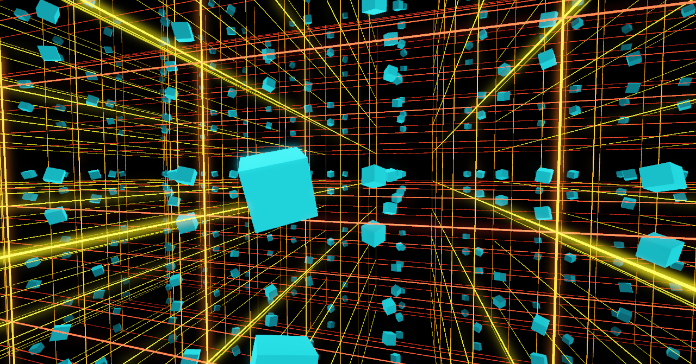
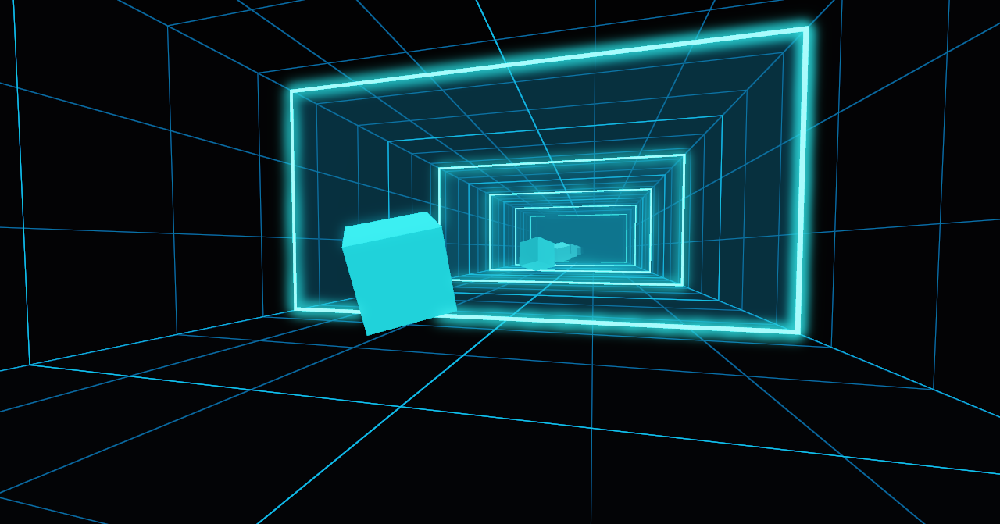

# Infinity Room / Infinity Cube

An interactive first-person scene built with the **method of images** — no
stencil masks, no recursive framebuffer reflections. Two modes share the same
12 x 6 x 10 cell: a mirrored corridor that repeats along Z, and a full 3-axis
neon lattice that repeats the cell in every direction. Rendering is HDR
(`RGBA16F`) with 4x MSAA, a soft-knee bright pass, a five-iteration separable
Gaussian bloom chain, ACES tonemapping and gamma 2.2 output.





C++17 · OpenGL 3.3 Core · GLFW 3.4 · GLM · GLAD · stb_image_write · CMake ≥ 3.16

---

## What it is

- A first-person scene: WASD + mouse look, clamped inside the real cell.
- **Tunnel mode**: two full-wall mirrors at `z = ±W/2` (`W = 10`) with emissive
  frames and ~5 % alpha glass, reflecting into a corridor.
- **Cube mode**: the same cell copied on X, Y and Z (`12 x 6 x 10`), with neon
  lattice edges and instanced cube copies. `M` switches modes; each mode keeps
  its own reflection depth.
- Live cubes: click to spawn neon cubes (up to 256), recolour, pause, change N,
  toggle reflections, clear spawns.
- HDR bloom, default on. `B` toggles it; `[` and `]` change its intensity.
- Scripted deterministic demo (`T` or `--demo`) and a frame recorder
  (`--record`) for video capture.
- HUD entirely in the window title (no text rendering): FPS, mode, N, bloom
  state/intensity, object count, demo and pause state.

## Requirements

- CMake 3.16 or newer and a C++17 compiler (MSVC 2019+, GCC 9+, Clang 10+).
- An OpenGL 3.3 Core capable driver.
- **Linux:** X11 development headers (`libx11-dev`, `libxrandr-dev`,
  `libxinerama-dev`, `libxcursor-dev`, `libxi-dev`). A `libGL` development
  package is optional: GLAD loads every GL entry point at runtime, and CMake
  links `OpenGL::GL` only when the platform provides it.
- **macOS:** Xcode Command Line Tools. The app requests
  `GLFW_OPENGL_FORWARD_COMPAT` for the core profile.
- **GLFW 3.4 and GLM are not system dependencies** — CMake FetchContent obtains
  them (GLFW 3.4, GLM 1.0.1).
- No new libraries were added for this version: bloom, the lattice, HDR targets
  and PNG capture use OpenGL, GLM and the existing `stb_image_write`.

## Build

### Linux / macOS

```bash
cmake -S . -B build -DCMAKE_BUILD_TYPE=Release
cmake --build build -j
./build/bin/InfinityRoom
```

### Windows (MSVC, from "Developer PowerShell for VS")

```powershell
cmake -S . -B build -A x64
cmake --build build --config Release
.\build\bin\Release\InfinityRoom.exe
```

The shaders are copied next to whichever executable is produced by a
`POST_BUILD` step (`build/bin/shaders`, or `build/bin/Release/shaders` for
multi-config generators). The application resolves them from the executable's
directory, never from the current working directory.

### Build offline / reuse existing GLFW and GLM sources

FetchContent accepts standard source overrides, so no download is needed if you
already have the sources:

```bash
cmake -S . -B build -DCMAKE_BUILD_TYPE=Release \
  -DFETCHCONTENT_SOURCE_DIR_GLFW=/path/to/glfw-3.4 \
  -DFETCHCONTENT_SOURCE_DIR_GLM=/path/to/glm
```

On the machine used for verification, nothing was installed; the existing local
copies were used:

| Dependency | Local source used here |
| --- | --- |
| GLFW 3.4 | `/media/taiyab/Volume E/glfw-3.4` |
| GLM 1.0.3 | `/media/taiyab/Volume E/glm` |
| GLAD 0.1.36 (gl:core=3.3) | `/media/taiyab/Volume E/glad` → copied to `third_party/glad` |
| stb_image_write v1.16 | GLFW's `deps/stb_image_write.h` → copied to `third_party/stb` |

Those `/media/...` paths only exist on the Linux machine that produced this
build; on Windows use the corresponding `D:\...` / `E:\...` paths. A normal
online configure ignores these overrides and downloads the pinned versions.

### Regenerating GLAD (optional)

The generated loader is committed, so this is only needed if you change the GL
version/profile. It requires the `glad` Python package (version 0.1.36 was used):

```bash
python3 -m pip install "glad==0.1.36"
python3 -m glad --profile=core --api="gl=3.3" --generator=c --spec=gl \
  --extensions="" --out-path=third_party/glad
```

## Controls

| Input | Action |
| --- | --- |
| **W / A / S / D** | Move (delta-time, clamped inside the real cell) |
| **Mouse** | Look; pitch clamped to ±89°; no jump on the first motion after capture |
| **Left click** | Re-capture the cursor if released, otherwise spawn a cube at camera + forward × 3 |
| **M** | Toggle Tunnel ⇄ Cube mode (each keeps its own N) |
| **1 – 9** | Set N. Tunnel: 1…9. Cube: 1…5, keys 6–9 clamp to 5 |
| **F** | Toggle reflections (N = 0 ⇄ the last non-zero N) in either mode |
| **B** | Toggle bloom |
| **[ / ]** | Decrease / increase bloom intensity by 0.10 (range 0…2) |
| **T** | Toggle the scripted demo camera (auto-spawn + N cycling) |
| **R** | Randomise the colours of all cubes |
| **Space** | Pause / resume cube animation and the demo clock |
| **C** | Clear spawned cubes, keep the initial cube |
| **Esc** | Release the cursor |
| **Esc** (while released) | Exit |

Window title examples:

```
Infinity Room | FPS 60 | CUBE N 3 | BLOOM 0.60 | Objects 1 | RUNNING
Infinity Room | FPS 60 | TUNNEL N 5 | BLOOM OFF | Objects 3 | DEMO | RUNNING
```

## Capture tools

```bash
# A still of cube mode at N = 5 (post-processed, PNG)
./build/bin/InfinityRoom --cube --depth 5 --screenshot cube.png

# Same frame with bloom disabled (ACES + gamma still applied)
./build/bin/InfinityRoom --cube --depth 5 --no-bloom --screenshot cube_flat.png

# 12-second deterministic camera move; --record enables the demo camera
./build/bin/InfinityRoom --cube --demo --record frames --seconds 12

# Encode the PNG sequence
ffmpeg -framerate 60 -i frames/frame_%05d.png -c:v libx264 -pix_fmt yuv420p out.mp4

# Small looping GIF (24 fps, 960 px wide, palette-optimised)
ffmpeg -framerate 60 -i frames/frame_%05d.png -vf \
  "fps=24,scale=960:-1:flags=lanczos,split[a][b];[a]palettegen[p];[b][p]paletteuse" \
  out.gif
```

- Frames are written at a fixed `1/60 s` timestep regardless of render speed, so
  the video is smooth even though PNG readback/encoding makes capture slower than
  real time. Frames are read from the final composited image (after bloom,
  tonemapping and gamma), flipped vertically, and written as `frame_%05d.png`.
- `--record` uses the same deterministic clock and demo on every run; two
  recordings of the same arguments produced byte-identical PNGs.
- `--seconds` defaults to 12 and is capped at 600.
- `--depth <n>` was added so captures can select the exact depth that the number
  keys select; cube mode clamps it to 5.
- `--screenshot` renders three frames with the clock starting at 0.9 s and keeps
  the last one.

## "Infinity Cube": the 3-axis method of images

1. The real cell occupies `x ∈ [-6, 6]`, `y ∈ [0, 6]`, `z ∈ [-5, 5]`, so its centre is `c = (0, 3, 0)` and its sizes are `Wx = 12`, `Wy = 6`, `Wz = 10`.
2. Copy `(i, j, k)` is the real cell reflected across the lattice planes; a real point `p` maps to `imagePos = c + (i·Wx, j·Wy, k·Wz) + ((-1)^i, (-1)^j, (-1)^k) · (p - c)`.
3. Copies span `[-N, N]³`; the product of the three signs is the copy's parity: +1 preserves handedness, −1 mirror-flips it.
4. Cubes are drawn once per copy with instancing; even-parity copies use `glFrontFace(GL_CCW)`, odd-parity copies use `GL_CW`, so mirrored copies are not back-face culled inside out.
5. Each copy is dimmed by `0.85^(|i|+|j|+|k|)`; the neon lattice is drawn only once per edge (owned by the cell at its minimum corner) so neighbouring copies never z-fight.

The 1331-copy N=5 shot above is the result: 11³ copies of every cube, all
placed by the vertex shader from three per-instance values (`offset`, `sign`,
`fade`) that are uploaded only when N or the mode changes.

## Bloom, in five lines

1. The scene renders into a 4x MSAA `RGBA16F` target (colour and depth renderbuffers); a blit resolves it into a single-sample `RGBA16F` texture.
2. All lighting is linear: authored sRGB colours are raised to 2.2 before lighting, and neon terms are allowed to exceed 1.0 (frames ≈ 3.5, lattice edges ≈ 4, cube rim ≈ 1.5).
3. A half-resolution bright pass keeps only above-threshold light with a soft knee around 1.0.
4. Five ping-pong iterations of a separable 9-tap Gaussian blur (horizontal then vertical) spread that light across half-resolution `RGBA16F` textures with clamp-to-edge and linear filtering.
5. The composite adds `scene + bloom * intensity`, applies the Narkowicz ACES fit and gamma 2.2; with bloom off the intensity is 0 but ACES and gamma still run.

## How the renderer works

- **Tunnel mode** (`Renderer::drawObjectsTunnel`, `Room.cpp`, `Mirror.cpp`):
  cubes are drawn for every copy `k` with `T(0, 0, kW) · S(1, 1, (-1)^k) · M`.
  Odd `k` switches `glFrontFace(GL_CW)` and flips the light's Z. The corridor is
  one long mesh; `room.frag` computes `k = floor(worldZ / W + 0.5)` and discards
  outside `|k| ≤ N`. Mirror frames are drawn once per boundary; glass is blended
  far-to-near with depth writes off; the two ends get opaque caps.
- **Cube mode** (`Renderer::drawObjectsCube`, `Lattice.cpp`): each cube is drawn
  twice per object, once for even-parity and once for odd-parity instances, with
  two instance buffers. The vertex shader applies the image formula above. The
  lattice is a set of thin boxes (0.04 units) instanced along the cell edges;
  every segment is owned by the cell at its minimum corner, so it is emitted
  exactly once. No room, corridor or glass is drawn in this mode.
- **Lighting**: ambient + Lambert using the unflipped world normal and the real
  light, plus an emissive term and a rim term using `sign * normal` and the view
  ray to the image position. Rim and neon can exceed 1.0 and feed bloom.
- **HDR targets** (`PostProcess.cpp`): `RGBA16F` scene, half-res bloom
  ping-pong targets, `GL_CLAMP_TO_EDGE`, linear filtering. Targets are recreated
  whenever the framebuffer size changes. If the 4x MSAA framebuffer cannot be
  completed, the renderer logs a warning and renders at 1x.
- **OpenGL objects** use RAII wrappers (`include/GLWrappers.h`) for VAO,
  VBO/EBO, textures, renderbuffers, framebuffers and programs; compile/link
  failures print the shader path and the driver log.
- **Determinism**: the demo camera is a sum of sines; auto-spawns use integer
  hashes and a golden-ratio hue walk; the recorder renders from the frame index
  rather than wall time.

## Tunables

Everything is in `include/Constants.h`: real cell size, cell centre, reflection
limits and per-mode defaults, copy falloff, lattice thickness/emissive/hue speed,
bloom threshold/knee/iterations/intensity step, demo path and spawn schedule,
camera, spawn limits, lighting and screenshot/record settings. Shader-internal
constants (hue blend cap, derivative epsilon, Gaussian weights) are named in the
relevant shader.

## Verification performed

- Built on Linux Mint 22.3 (kernel 7.0.0), GCC 13.3.0, CMake 3.28.3, X11, with
  `-Wall -Wextra`: **0 warnings**, link success.
- Ran on the physical display with an NVIDIA RTX 2060 (driver 595.91.07,
  OpenGL 3.3 Core). Startup logs confirmed `Post: RGBA16F scene 1280x720,
  bloom 640x360, scene MSAA 4x`.
- Generated and inspected these PNGs:
  - `screenshots/tunnel_hdr.png` — tunnel mode, bloom on,
  - `screenshots/cube_hdr.png` — cube mode, default N=3,
  - `screenshots/cube_n5.png` — cube mode, N=5 (1331 copies),
  - `screenshots/cube_n5_nobloom.png` — same, bloom off, tonemapping still on.
- Fixed two bugs found while testing: the lattice edge boxes were initially
  scaled to half their intended length (segments did not meet at corners), and
  the cube mesh's winding was corrected before this version.
- Recorded 60 frames with `--cube --depth 5 --record ... --seconds 1`: exactly
  60 valid 1280x671 RGBA PNGs and a clean exit. Repeated the same 30-frame
  capture twice; `diff -rq` reported byte-identical output.
- Drove the live app through X11 key injection and read the window title after
  each key: `B` → `BLOOM OFF`, `]` → `BLOOM 0.70` after re-enabling bloom,
  `M` → `TUNNEL N 5` while cube had `N 3`, `M` again → `CUBE N 3` (per-mode N
  preserved), `T` → `DEMO` and an auto-spawned cube.
- Resized the live cube-mode window (N=5) from 1280 x 671 to 900 x 600; the
  title kept reporting 60 FPS, confirming the HDR/bloom targets are recreated
  on resize without errors.
- Performance: at cube mode `N = 5` (1331 cube copies, 3993 lattice boxes) with
  bloom and 4x MSAA, the title held `FPS 60` for several seconds at 1280 x 671
  on the RTX 2060. Vsync was on, so this proves the frame budget is met, not the
  headroom; a mid-range GPU was **not** available to confirm the 60 FPS target.
- **Not tested:** MSVC/Windows and macOS builds (platform branches implemented,
  no machine available), physical HiDPI scaling, and forcing the MSAA-fallback
  path (no driver here refused the 4x RGBA16F target). The demo-pose screenshot
  `screenshots/demo_pose.png` is from a short `--demo --cube --screenshot` run.

## Known limitations

- Flat parallel mirrors/cells only; no curved mirrors, corner cubes, per-pixel
  recursive reflections or ray tracing. Beyond `[-N, N]` there is nothing.
- The per-copy fade (`0.85^Manhattan`) is a visual hack, not energy-conserving.
  It hides the edge of the finite copy set but also makes distant copies dimmer
  than a physically correct infinite lattice would be.
- No shadows, ambient occlusion, textures, imported models or physics.
- The camera is clamped inside the real cell, so you can never fly into the
  copies; the demo stays inside it as well.
- Lattice edges are emissive boxes and can overlap at cell corners; culling is
  disabled for them, so the overlap is not visible as missing faces.
- The HUD is the window title; there is no in-window text.
- Recording is slower than real time because each frame is read back and PNG
  encoded synchronously.
- Screenshot/record resolution follows the actual framebuffer; some window
  managers shrink the client area (the verification captures are 1280 x 671).
- The bundled GLFW build on Linux uses the X11 backend (works under XWayland);
  Wayland is intentionally disabled to avoid extra dev dependencies.

## Assumptions

- Cube mode defaults to `N = 3`; tunnel mode keeps its original default `N = 5`.
  Each mode remembers its own depth, including `N = 0` from `F`.
- Cube-mode keys 6–9 clamp to 5, as requested. `--depth` (not requested, added
  for reproducible captures) is clamped the same way.
- Bloom defaults to on with intensity 0.60; the step is 0.10, range 0.0–2.0.
- The camera start pose is unchanged from the tunnel version: `(2.0, 1.7, 3.6)`,
  yaw −104°, pitch −2°; it is also inside the cube-mode cell.
- The demo starts with the initial cube already present and auto-spawns up to 12
  total cubes (initial included) every 0.4 s; it advances N every 8 s.
  `--record` enables the demo automatically because recording has no input.
- The screenshot clock starts at 0.9 s as before, but screenshot mode now reads
  the post-processed default framebuffer, not the raw scene.
- `R` randomises colours with `std::random_device`; demo spawns are deterministic,
  but interactive spawns are intentionally not.
- Lattice fades use the owning cell's Manhattan index. Only cells in `[-N, N]³`
  emit their three minimum-corner segments, so the outermost positive boundary
  consists of edge endpoints rather than a fully closed duplicate shell.
- The MSAA target uses renderbuffers rather than multisampled textures because
  it is only ever blitted; the resolved scene is a texture.
- `include/GLWrappers.h` and `third_party/stb/stb_image_write.h` remain additions
  to the requested layout (RAII helpers and the PNG writer).
- GLAD was generated once with glad 0.1.36
  (`--profile=core --api="gl=3.3" --generator=c --spec=gl --extensions=""`) and
  the generated files are committed under `third_party/glad`; the Python package
  is not needed to build.
- GLFW is configured with `GLFW_BUILD_X11=ON` and `GLFW_BUILD_WAYLAND=OFF` on
  Linux so the build works without Wayland development packages.

## Project layout

```
InfinityRoom/
  CMakeLists.txt
  README.md
  .gitignore
  include/
    Camera.h  Constants.h  GLWrappers.h  Lattice.h  Mirror.h  Object.h
    PostProcess.h  Renderer.h  Room.h
  src/
    main.cpp  Camera.cpp  Lattice.cpp  Mirror.cpp  Object.cpp
    PostProcess.cpp  Renderer.cpp  Room.cpp
  shaders/
    basic.vert  basic.frag  room.frag  mirror.frag
    edge.vert  edge.frag  fullscreen.vert
    bright.frag  blur.frag  composite.frag
  third_party/
    glad/include/glad/glad.h
    glad/include/KHR/khrplatform.h
    glad/src/glad.c
    stb/stb_image_write.h
  screenshots/
    infinity_room.png        (earlier non-HDR build)
    tunnel_hdr.png
    cube_hdr.png
    cube_n5.png
    cube_n5_nobloom.png
```

Third-party licences: GLFW (zlib), GLM (MIT), GLAD-generated code (MIT/CC0),
stb_image_write (public domain / MIT).
